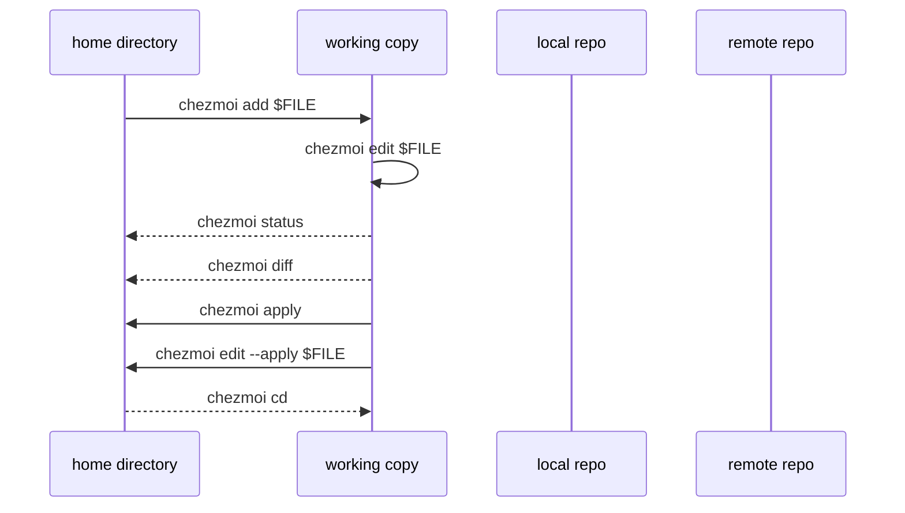
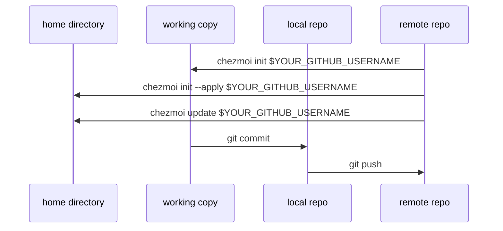

# Command overview

## Getting started

- [`chezmoi doctor`][doctor-command] checks for common problems. If you
  encounter something unexpected, run this first.

- [`chezmoi init`][init-command] creates chezmoi's source directory and a git
  repo on a new machine.

## Daily commands

- [`chezmoi add $FILE`][add-command] adds `$FILE`from your home directory to the
  source directory.

- [`chezmoi edit $FILE`][edit-command] opens your editor with the file in the
  source directory that corresponds to `$FILE`.

- [`chezmoi status`][status-command] gives a quick summary of what files would
  change if you ran `chezmoi apply`.

- [`chezmoi diff`][diff-command] shows the changes that `chezmoi apply` would
  make to your home directory.

- [`chezmoi apply`][apply-command] updates your dotfiles from the source
  directory.

- [`chezmoi edit --apply $FILE`][edit-command] is like `chezmoi edit $FILE` but
  also runs `chezmoi apply $FILE` afterwards.

- [`chezmoi cd`][cd-command] opens a subshell in the source directory.

## Using chezmoi across multiple machines

- [`chezmoi init $YOUR_GITHUB_USERNAME`][init-command] clones your dotfiles from
  GitHub into the source directory.

- [`chezmoi init --apply $YOUR_GITHUB_USERNAME`][init-command] clones your
  dotfiles from GitHub into the source directory and runs `chezmoi apply`.

- [`chezmoi update`][update-command] pulls the latest changes from your remote
  repo and runs `chezmoi apply`.

- Use normal git commands to add, commit, and push changes to your remote repo.

## Working with templates

- [`chezmoi data`][data-command] prints the available template data.

- [`chezmoi add --template $FILE`][add-command] adds `$FILE` as a template.

- [`chezmoi chattr +template $FILE`](/reference/commands/chattr.md) makes an
  existing file a template.

- [`chezmoi cat $FILE`][cat-command] prints the target contents of `$FILE`,
  without changing `$FILE`.

- [`chezmoi execute-template`][execute-template-command] is
  useful for testing and debugging templates.

[add-command]: /reference/commands/add.md
[apply-command]: /reference/commands/apply.md
[cat-command]: /reference/commands/cat.md
[cd-command]: /reference/commands/cd.md
[data-command]: /reference/commands/data.md
[diff-command]: /reference/commands/diff.md
[doctor-command]: /reference/commands/doctor.md
[edit-command]: /reference/commands/edit.md
[execute-template-command]: /reference/commands/execute-template.md
[init-command]: /reference/commands/init.md
[status-command]: /reference/commands/status.md
[update-command]: /reference/commands/update.md
